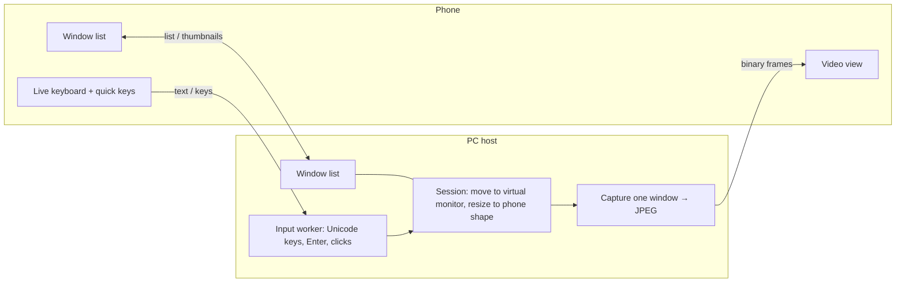

# WinRelay MVP

Control one PC window at a time from your phone. The phone lists the PC's open windows, you tap one, it fills the phone screen, and the phone keyboard types into it. Enter is a real Return key. Stealth mode moves the window onto a hidden virtual monitor, so the PC's own screen never shows it.

```
winrelay/
├── host/                  Windows PC app (Rust)
│   ├── Cargo.toml
│   ├── ui/index.html      Desktop UI, served on http://localhost:47800/ui
│   └── src/
│       ├── main.rs        Start-up, dual-stack listener, emergency hotkey
│       ├── server.rs      Phone protocol, pairing approval, desktop UI API
│       ├── winlist.rs     Lists windows, hidden-app filter
│       ├── session.rs     Move/resize/restore, stealth, taskbar, cursor fence, crash recovery
│       ├── capture.rs     One-window capture, JPEG encode, capture thread
│       ├── input.rs       Unicode typing, named keys, clicks, scroll (ordered worker thread)
│       ├── display.rs     Monitors, virtual monitor detection
│       ├── power.rs       Keep awake, screens off, lock detection
│       ├── net.rs         Addresses, pairing link
│       ├── config.rs      Settings, devices, activity log
│       └── protocol.rs    Message types (shared contract with the phone)
└── mobile/                Phone app (Flutter, iOS + Android)
    ├── pubspec.yaml
    └── lib/
        ├── main.dart
        ├── models.dart        PC, window, settings, pairing-link parser
        ├── store.dart         Saved PCs and settings
        ├── connection.dart    WebSocket client, frames, auto re-open after reconnect
        ├── screens/           pair, pcs, windows, control, settings
        └── widgets/           live_keyboard, video_view, quick_keys
```

## Important: this code has not been compiled yet

It was written without access to a Rust or Flutter toolchain. It targets pinned versions (`windows` 0.58, `axum` 0.7, Flutter 3.22+), but expect a handful of small compile fixes on first build, mostly around `windows-rs` function signatures, which change between versions. Paste the compiler errors into Cursor or Claude and they are quick to fix. The logic and structure are complete.

## How it works



One WebSocket on one TCP port (default 47800) carries everything. The host binds `[::]` in dual-stack mode, so IPv4 and IPv6 both work.

## Differences from the design doc (MVP shortcuts)

| Design | MVP | Why | Upgrade path |
| --- | --- | --- | --- |
| WebRTC, H.264 | WebSocket, JPEG frames, only when the window changes | No extra native code on the phone; easy to debug | Swap `capture.rs` + `connection.dart` for WebRTC (GStreamer `webrtcbin` / `flutter_webrtc`) |
| Windows Graphics Capture | `PrintWindow(PW_RENDERFULLCONTENT)` | Fewer moving parts; works for covered windows and the virtual monitor | WGC via the `windows-capture` crate for lower CPU and 30+ fps |
| 6-digit code on both screens | Phone name shown on the PC, you click Approve | Simpler; still needs someone at the PC | Add the code to `Pending` and both UIs |
| Autocorrect in live typing | Autocorrect off in live mode, on in Compose mode | Autocorrect rewrites text that was already sent | — |
| Tray icon | Browser-based UI that opens on start | No tray library needed | Add the `tray-icon` crate |
| Lock "when a session ends" | Lock when the phone disconnects | Locking between windows would block the next one | — |

## Set up the PC (Windows 10/11)

1. **Build the host.** Install Rust from rustup.rs, then:
   ```
   cd host
   cargo build --release
   ```
   Run `target\release\winrelay-host.exe`. The desktop UI opens in your browser.
2. **Install a virtual display driver** (needed for stealth and phone-shaped windows). For example, the open-source Virtual Display Driver project on GitHub (VirtualDrivers/Virtual-Display-Driver). Configure one monitor with a tall or square resolution, such as 1440 × 2560 or 2160 × 2160. In Windows Display settings, place it at the far edge of your real screens. WinRelay finds it by adapter name; if the Checks list on Home says "Not found", put a word from its name in Settings → Virtual display name contains.
3. **Allow it through the firewall.** Click Allow in firewall on Home and accept the admin prompt.
4. **Recommended Windows settings:** Power → Sleep: Never while plugged in. Laptop lid close: Do nothing. Lock screen auto-lock: off while you use WinRelay (Windows blocks capture and typing on the lock screen). Use Settings → Lock this PC when the phone disconnects instead.
5. **For use away from home:** turn on Settings → Allow connections over the internet. Your router must allow inbound IPv6 on port 47800 (often called "IPv6 firewall" or "pinhole"). A dynamic DNS name avoids broken links when your IPv6 address changes.

## Set up the phone app

```
flutter create winrelay_app --org com.example --platforms=android,ios
# copy mobile/pubspec.yaml and mobile/lib/ over the generated ones
cd winrelay_app && flutter pub get && flutter run
```

**Android** (`android/app/src/main/AndroidManifest.xml`): add inside `<manifest>`
```xml
<uses-permission android:name="android.permission.INTERNET"/>
<uses-permission android:name="android.permission.CAMERA"/>
```
and on `<application>` add `android:usesCleartextTraffic="true"` (the MVP uses `ws://`; see Security).

**iOS** (`ios/Runner/Info.plist`):
```xml
<key>NSCameraUsageDescription</key><string>Scan the pairing code shown on your PC.</string>
<key>NSLocalNetworkUsageDescription</key><string>Connect to WinRelay on your PC.</string>
<key>NSAppTransportSecurity</key><dict><key>NSAllowsArbitraryLoads</key><true/></dict>
```

## Using it

1. On the PC, Home shows a QR code. On the phone, tap Pair a PC and scan it.
2. The PC shows "Pixel 9 wants to connect". Click Approve. The phone gets its own key; the link stops working.
3. The phone lists windows grouped by app. Turn on Hide the window on the PC for stealth, then tap a window.
4. Tap the keyboard button and type. Return sends Enter. Quick keys cover Esc, Tab, Shift+Tab, Ctrl+C, arrows, New line (Shift+Enter) and Paste.
5. View mode (default): taps never click; drag scrolls; pinch zooms the picture. Tap mode: tap = click, long-press = right click, double-tap = double click.
6. Back arrow ends control; the window returns to where it was. On the PC, End session or Ctrl+Alt+Shift+R does the same from that side.

## Protocol

Text frames are JSON with a `t` field. Binary frames are `[kind u8][window id u64 LE][width u32 LE][height u32 LE][JPEG]`, kind 1 = video, 2 = thumbnail.

| Phone → PC | Fields |
| --- | --- |
| `hello` | `device_id`, `device_name`, `token` (pairing) or `secret` (paired) |
| `list` | — |
| `thumb` | `id` |
| `open` | `id`, `stealth`, `viewport {w,h,dpr}`, `scale` |
| `viewport` | `viewport` (after rotation) |
| `close` | — |
| `text` | `s` (`\n` = Return) |
| `key` | `k`: enter, shift_enter, ctrl_enter, backspace, esc, tab, shift_tab, ctrl_c, ctrl_v, ctrl_z, up, down, left, right, home, end, pgup, pgdn, delete |
| `tap` | `x`, `y` (0–1 within the picture), `kind`: left, right, double |
| `scroll` | `dy` (wheel notches, positive = up) |
| `ping` | — |

| PC → phone | Fields |
| --- | --- |
| `welcome` | `host` |
| `pending` / `approved` / `denied` | `secret` / `reason` |
| `windows` | `items [{id,title,app,exe}]` |
| `opened` / `closed` | `id,title,stealth` / `reason` |
| `locked` | `locked` |
| `error` | `msg` |
| `pong` | — |

## Security in this MVP

- Phones need a one-time pairing link **and** a click on Approve at the PC; after that each phone proves itself with its own 40-character secret.
- Five failed hellos from one address block it for an hour.
- Home network only by default; internet connections are refused unless you turn them on.
- The desktop UI and its API answer only on localhost.
- Hidden apps (password managers by default) never appear and can't be opened by id.
- **Not yet encrypted.** `ws://` is fine on your own Wi-Fi but should not be used over the internet. Before turning on internet access, add TLS: generate a self-signed certificate on first run, serve `wss://` with `axum-server` + `rustls`, put the certificate fingerprint in the pairing link, and pin it in the phone app. This is the first item on the roadmap.

## Known limitations

- **Locked PC:** Windows blocks capture and typing on the lock screen. The phone shows a notice.
- **Screens off + typing:** injected keystrokes count as activity and wake the monitors; WinRelay switches them off again after 1.5 s of quiet, so the screens may flash briefly.
- **Stealth is against glances:** Alt+Tab and Task Manager can still list the window.
- **Admin windows** ignore input from a non-admin app; run the host as administrator to control them.
- **CPU:** PrintWindow at 15 fps on a large window uses noticeable CPU; lower the frame rate or move to WGC.
- **Some apps refuse resizing** or are full-screen; they show at their own size with pinch zoom.

## Roadmap after the MVP

1. TLS with certificate pinning (required before internet use).
2. Windows Graphics Capture + hardware H.264 over WebRTC.
3. Tray icon and toast notifications.
4. Six-digit pairing code on both screens.
5. Terminal text lane: run Claude Code in a host-managed terminal and send text instead of pictures.
6. macOS host (ScreenCaptureKit + CGEvent).
